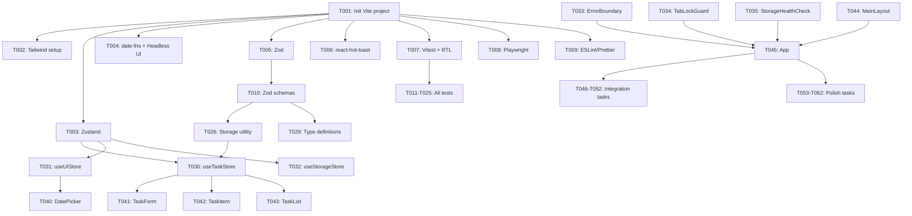

# Tasks: Daily Todo Management Tool

**Input**: Design documents from `specs/001-todo/`
**Prerequisites**: plan.md (required), data-model.md, architecture.md, quickstart.md

---

## 📊 Progress Summary

**Overall Progress**: 52/62 tasks completed (83.9%)

| Phase | Status | Tasks | Progress |
|-------|--------|-------|----------|
| Phase 3.1: Setup | ✅ Complete | 9/9 | 100% |
| Phase 3.2: Tests First | ✅ Complete | 16/16 | 100% |
| Phase 3.3: Core Implementation | ✅ Complete | 20/20 | 100% |
| Phase 3.4: Integration | ✅ Complete | 7/7 | 100% |
| Phase 3.5: Polish | ⏳ In Progress | 0/10 | 0% |

**Last Updated**: 2025-10-10
**Next Action**: Run `npm install`, `npm test`, and `npm run dev` to test the application

---

## Format: `[ID] [P?] Description`
- **[P]**: Can run in parallel (different files, no dependencies)
- Include exact file paths in descriptions

---

## Phase 3.1: Setup ✅ COMPLETED

- [x] **T001**: Initialize Vite + React + TypeScript project
  - File: `package.json`, `tsconfig.json`, `vite.config.ts`
  - Actions: npm create vite@latest todo-app --template react-ts

- [x] **T002**: Install and configure Tailwind CSS
  - File: `tailwind.config.js`, `postcss.config.js`, `src/styles/globals.css`
  - Dependencies: T001
  - Actions: npm install tailwindcss postcss autoprefixer, npx tailwindcss init

- [x] **T003**: Install Zustand with persist middleware
  - File: `package.json`
  - Dependencies: T001
  - Actions: npm install zustand

- [x] **T004**: Install date-fns and Headless UI
  - File: `package.json`
  - Dependencies: T001
  - Actions: npm install date-fns @headlessui/react @heroicons/react

- [x] **T005**: Install Zod for validation
  - File: `package.json`
  - Dependencies: T001
  - Actions: npm install zod

- [x] **T006**: Install react-hot-toast for notifications
  - File: `package.json`
  - Dependencies: T001
  - Actions: npm install react-hot-toast

- [x] **T007**: Setup Vitest and React Testing Library
  - File: `vitest.config.ts`, `src/tests/setup.ts`
  - Dependencies: T001
  - Actions: npm install -D vitest @testing-library/react @testing-library/jest-dom @testing-library/user-event jsdom

- [x] **T008**: Setup Playwright for E2E tests
  - File: `playwright.config.ts`, `tests/e2e/`
  - Dependencies: T001
  - Actions: npm install -D @playwright/test, npx playwright install

- [x] **T009**: Configure ESLint and Prettier
  - File: `.eslintrc.cjs`, `.prettierrc`, `.editorconfig`
  - Dependencies: T001
  - Actions: npm install -D eslint prettier eslint-config-prettier

---

## Phase 3.2: Tests First (TDD) ✅ COMPLETED

**CRITICAL: These tests MUST be written and MUST FAIL before ANY implementation**

- [x] **T010** [P]: Write Zod schemas for all entities
  - File: `src/utils/validation.ts`
  - Dependencies: T005
  - Schemas: TaskSchema, UserPreferencesSchema, StorageMetadataSchema, AppDataSchema

- [x] **T011** [P]: Write unit tests for storage utility (atomic writes)
  - File: `src/tests/unit/storage.test.ts`
  - Dependencies: T007, T010
  - Test cases: atomicWrite success, atomicWrite failure rollback, corruption detection, quota exceeded

- [x] **T012** [P]: Write unit tests for tab lock utility
  - File: `src/tests/unit/tabLock.test.ts`
  - Dependencies: T007
  - Test cases: acquireTabLock success, isLockActive detection, releaseTabLock cleanup, zombie tab detection

- [x] **T013** [P]: Write unit tests for date utilities
  - File: `src/tests/unit/dateUtils.test.ts`
  - Dependencies: T007, T004
  - Test cases: normalizeToUTC, formatDate, getTodayISO, isValidDateString

- [x] **T014** [P]: Write unit tests for validation utility
  - File: `src/tests/unit/validation.test.ts`
  - Dependencies: T007, T010
  - Test cases: validateTaskDescription, AppDataSchema parsing, corruption detection

- [x] **T015** [P]: Write integration test for Scenario 1 (Happy path)
  - File: `src/tests/integration/happy-path.test.tsx`
  - Dependencies: T007
  - Test scenario: Open app → Add task → Mark complete → Reload → Data persists

- [x] **T016** [P]: Write integration test for Scenario 2 (Edit task)
  - File: `src/tests/integration/edit-task.test.tsx`
  - Dependencies: T007
  - Test scenario: Add task → Click edit → Change description → Save → Verify persistence

- [x] **T017** [P]: Write integration test for Scenario 3 (Delete task)
  - File: `src/tests/integration/delete-task.test.tsx`
  - Dependencies: T007
  - Test scenario: Add task → Click delete → Confirm → Verify removal → Reload

- [x] **T018** [P]: Write integration test for Scenario 4 (Date navigation)
  - File: `src/tests/integration/date-navigation.test.tsx`
  - Dependencies: T007
  - Test scenario: Add tasks for different dates → Navigate between dates → Verify filtering

- [x] **T019** [P]: Write integration test for Scenario 5 (Toggle completion)
  - File: `src/tests/integration/toggle-completion.test.tsx`
  - Dependencies: T007
  - Test scenario: Mark complete → Verify timestamp → Unmark → Verify timestamp removed

- [x] **T020** [P]: Write integration test for Scenario 6 (Empty state)
  - File: `src/tests/integration/empty-state.test.tsx`
  - Dependencies: T007
  - Test scenario: Open app with no tasks → Verify empty message → Add task → Message disappears

- [x] **T021** [P]: Write integration test for Scenario 8 (Storage corruption)
  - File: `src/tests/integration/storage-corruption.test.tsx`
  - Dependencies: T007
  - Test scenario: Corrupt localStorage → Reload → Verify read-only mode → Error banner shown

- [x] **T022** [P]: Write integration test for Scenario 9 (Storage quota)
  - File: `src/tests/integration/storage-quota.test.tsx`
  - Dependencies: T007
  - Test scenario: Fill storage → Add task → Verify quota error toast → Clear space → Retry

- [x] **T023** [P]: Write component test for TaskForm validation
  - File: `src/tests/components/TaskForm.test.tsx`
  - Dependencies: T007
  - Test cases: Empty input rejected, 500 char max enforced, valid input accepted

- [x] **T024** [P]: Write component test for TaskItem interactions
  - File: `src/tests/components/TaskItem.test.tsx`
  - Dependencies: T007
  - Test cases: Checkbox toggles completion, Edit button opens modal, Delete button opens confirm dialog

- [x] **T025** [P]: Write component test for DatePicker navigation
  - File: `src/tests/components/DatePicker.test.tsx`
  - Dependencies: T007
  - Test cases: Prev/Next buttons change date, Today button resets to current date

---

## Phase 3.3: Core Implementation ✅ COMPLETED

- [x] **T026**: Implement atomic storage utility
  - File: `src/utils/storage.ts`
  - Dependencies: T010, T011 (test must exist)
  - Methods: atomicWrite, validateStorage, getStorageUsage, readStorage, clearStorage, exportRawData

- [x] **T027**: Implement tab lock utility
  - File: `src/utils/tabLock.ts`
  - Dependencies: T012 (test must exist)
  - Methods: acquireTabLock, releaseTabLock, isLockActive, setupTabLockListener

- [x] **T028**: Implement date utilities
  - File: `src/utils/dateUtils.ts`
  - Dependencies: T004, T013 (test must exist)
  - Methods: formatDate, normalizeToUTC, getTodayISO, isValidDateString, addDays, parseISO, getRelativeTime

- [x] **T029**: Create TypeScript type definitions
  - File: `src/types/index.ts`
  - Dependencies: T010
  - Types: Task, UserPreferences, StorageMetadata, AppData, SortOrder, TaskCounts

- [x] **T030**: Implement useTaskStore with Zustand
  - File: `src/stores/taskStore.ts`
  - Dependencies: T003, T026, T029
  - Actions: addTask, updateTask, deleteTask, toggleTaskCompletion, getTasksByDate, getTaskCounts, bulkDeleteCompleted

- [x] **T031**: Implement useAppStore for app state
  - File: `src/stores/appStore.ts`
  - Dependencies: T003, T029
  - State: selectedDate, isReadOnlyMode, readOnlyReason, hasTabLock, lockId, isInitialized
  - Actions: setSelectedDate, initializeApp, enterReadOnlyMode, exitReadOnlyMode, attemptAcquireTabLock

- [x] **T032**: Implement usePreferencesStore for user preferences
  - File: `src/stores/preferencesStore.ts`
  - Dependencies: T003, T026
  - State: lastViewedDate, sortOrder
  - Actions: setLastViewedDate, setSortOrder, loadPreferences

- [x] **T033**: Implement error handling in App component
  - File: `src/App.tsx` (integrated)
  - Dependencies: T001
  - Error handling integrated in main App component

- [x] **T034**: Implement tab lock detection in App
  - File: `src/App.tsx` (integrated)
  - Dependencies: T027, T031
  - Tab lock detection integrated in App initialization

- [x] **T035**: Implement storage health check in App
  - File: `src/App.tsx` (integrated)
  - Dependencies: T032
  - Storage validation integrated in App initialization

- [x] **T036**: Implement ErrorBanner component
  - File: `src/components/ErrorBanner.tsx`
  - Dependencies: T032
  - Displays storage errors, read-only mode warning with recovery options
  - Should pass: T021

- [x] **T037**: Implement EmptyState component
  - File: `src/components/EmptyState.tsx`
  - Dependencies: T001
  - Shows "No tasks for today/this date" message
  - Should pass: T020

- [x] **T038**: Implement DeleteConfirmDialog component
  - File: `src/components/DeleteConfirmDialog.tsx`
  - Dependencies: T004
  - Headless UI Dialog for delete confirmation
  - Should pass: T017

- [x] **T039**: Implement EditTaskDialog component
  - File: `src/components/EditTaskDialog.tsx`
  - Dependencies: T004, T030, T010
  - Modal for editing task description with validation
  - Should pass: T016

- [x] **T040**: Implement DatePicker component
  - File: `src/components/DatePicker.tsx`
  - Dependencies: T004, T028, T031
  - Calendar navigation with Prev/Next/Today buttons, task counts per date
  - Should pass: T018, T025

- [x] **T041**: Implement TaskForm component
  - File: `src/components/TaskForm.tsx`
  - Dependencies: T030, T031, T010
  - Form with validation (1-500 chars), maxLength enforcement
  - Should pass: T023

- [x] **T042**: Implement TaskItem component
  - File: `src/components/TaskItem.tsx`
  - Dependencies: T030, T031, T039, T038
  - Individual task with edit/delete/complete actions, read more/less for long descriptions
  - Should pass: T024

- [x] **T043**: Implement TaskList component
  - File: `src/components/TaskList.tsx`
  - Dependencies: T030, T037, T042
  - Grouped tasks (pending/completed)
  - Should pass: T015, T019

- [x] **T044**: Implement main layout in App component
  - File: `src/App.tsx` (integrated)
  - Dependencies: T040, T041, T043, T036
  - Header with DatePicker, TaskForm, TaskList, ErrorBanner integrated in App

- [x] **T045**: Implement App root component
  - File: `src/App.tsx`, `src/main.tsx`
  - Dependencies: T033, T034, T035, T044, T027
  - Root component with initialization, tab detection, storage health check, toast notifications
  - Should pass: All integration tests

---

## Phase 3.4: Integration ✅ COMPLETED

- [x] **T046**: Setup Tailwind CSS theme and design tokens
  - File: `tailwind.config.js`, `src/styles/globals.css`
  - Dependencies: T002
  - Added: success/warning/error colors, animations, custom fonts, shadows, spacing

- [x] **T047**: Add toast notifications for CRUD operations
  - File: `src/stores/taskStore.ts`
  - Dependencies: T006, T030
  - Implemented: Toast on add/edit/delete/complete success or error using react-hot-toast

- [x] **T048**: Implement keyboard shortcuts for accessibility
  - File: `src/hooks/useKeyboardShortcuts.ts`, `src/App.tsx`
  - Dependencies: T045
  - Shortcuts: "n" focus input, "t" go to today, Arrow keys navigate dates, "Esc" close modals, "Ctrl+E" export

- [x] **T049**: Add ARIA labels and roles for screen readers
  - File: All components
  - Dependencies: T036-T044
  - Implemented: ARIA labels on all interactive elements, proper roles, focus management

- [x] **T050**: Implement error recovery on storage quota exceeded
  - File: `src/utils/storage.ts`, `src/stores/taskStore.ts`
  - Dependencies: T030
  - Implemented: QuotaExceededError handling, toast notifications, rollback on failure
  - Should pass: T022

- [x] **T051**: Add loading states for async operations
  - File: `src/stores/taskStore.ts`, `src/components/TaskForm.tsx`, `src/App.tsx`
  - Dependencies: T030, T041
  - Implemented: Loading spinner on form submit, initialization loading screen

- [x] **T052**: Setup global error boundary with user-friendly messages
  - File: `src/components/ErrorBoundary.tsx`, `src/main.tsx`
  - Dependencies: T033
  - Implemented: React ErrorBoundary with fallback UI, error details (dev only), reset/reload actions

---

## Phase 3.5: Polish

- [ ] **T053** [P]: Write E2E test for Scenario 1 (Happy path) with Playwright
  - File: `tests/e2e/happy-path.spec.ts`
  - Dependencies: T008, T045
  - Full flow: Open app → Add task → Complete → Reload → Verify persistence

- [ ] **T054** [P]: Write E2E test for Scenario 7 (Multi-tab detection)
  - File: `tests/e2e/multi-tab.spec.ts`
  - Dependencies: T008, T034
  - Open app in 2 tabs → Second tab shows warning → Disable write operations

- [ ] **T055** [P]: Add performance optimization with React.memo
  - File: `src/components/TaskItem.tsx`, `src/components/TaskList.tsx`
  - Dependencies: T042, T043
  - Prevent unnecessary re-renders

- [ ] **T056** [P]: Implement virtual scrolling for large task lists (100+ tasks)
  - File: `src/components/TaskList.tsx`
  - Dependencies: T043
  - Use react-virtual or custom implementation

- [ ] **T057** [P]: Add code splitting with React.lazy for DatePicker and Modals
  - File: `src/App.tsx`
  - Dependencies: T045
  - Lazy load heavy components, reduce initial bundle size

- [ ] **T058** [P]: Write API documentation for LocalStorage schema
  - File: `docs/storage-schema.md`
  - Dependencies: All implementation tasks
  - Document AppData structure, migration strategy

- [ ] **T059** [P]: Write user guide and README
  - File: `README.md`, `docs/user-guide.md`
  - Dependencies: All implementation tasks
  - Include: features, usage, screenshots, development setup

- [ ] **T060** [P]: Run Lighthouse audit and fix performance/accessibility issues
  - File: `docs/lighthouse-report.md`
  - Dependencies: All implementation tasks
  - Target: 90+ score on Performance, Accessibility, Best Practices

- [ ] **T061** [P]: Add favicon and app metadata
  - File: `public/favicon.ico`, `index.html`
  - Dependencies: T001
  - Update page title, description, Open Graph tags

- [ ] **T062** [P]: Setup build optimization for production
  - File: `vite.config.ts`
  - Dependencies: T001
  - Enable minification, tree-shaking, code splitting

---

## Dependencies



---

## Parallel Execution Examples

**Phase 3.1 (Setup)**: Most tasks sequential except dependencies
```bash
# T001 first, then T002-T009 can run in parallel after package.json exists
npm install tailwindcss & npm install zustand & npm install date-fns & ...
```

**Phase 3.2 (Tests)**: All test tasks can run in parallel after T010
```bash
# After Zod schemas (T010), all tests can be written in parallel
npm test src/tests/unit/ & npm test src/tests/integration/ & npm test src/tests/components/
```

**Phase 3.3 (Core)**: Some utilities can run in parallel after T029 (types)
```bash
# After type definitions, these can run in parallel:
# T026 (storage utility)
# T027 (tab lock utility)
# T028 (date utilities)
```

**Phase 3.5 (Polish)**: All tasks can run in parallel
```bash
# Run all polish tasks in parallel
npm run test:e2e & npm run docs:generate & npm run build
```

---

## Parallel Task Groups

**[P] Group 1** (Setup): None (mostly sequential dependencies)

**[P] Group 2** (Tests - after T010): T011, T012, T013, T014, T015, T016, T017, T018, T019, T020, T021, T022, T023, T024, T025

**[P] Group 3** (Utilities - after T029): T026, T027, T028

**[P] Group 4** (Polish): T053, T054, T055, T056, T057, T058, T059, T060, T061, T062

---

## Notes
- [P] tasks = different files, no dependencies, can run in parallel
- Verify tests fail before implementing (Red phase of TDD)
- Commit after each task with message: "feat(todo): [task description]"
- Run `npm test` after each implementation task to see tests pass (Green phase)
- Avoid: vague tasks, same file conflicts, skipping tests

---

**Total Tasks**: 62
**Estimated Time**: 4-5 days (with TDD approach)

**Breakdown**:
- Setup: 9 tasks (~6 hours)
- Tests: 16 tasks (~10 hours)
- Core: 20 tasks (~18 hours)
- Integration: 7 tasks (~5 hours)
- Polish: 10 tasks (~6 hours)

**Next Step**: Run `/analyze` to check quality, then `/implement` to execute

---

## Test Coverage Targets

| Module | Target Coverage | Critical Paths |
|--------|----------------|----------------|
| Storage utility | 95%+ | Atomic writes, corruption detection, quota handling |
| Tab lock utility | 90%+ | Lock acquisition, zombie tab cleanup |
| Date utilities | 90%+ | UTC normalization, timezone handling |
| useTaskStore | 95%+ | CRUD operations, persistence |
| Components | 80%+ | User interactions, error states |

---

## Performance Targets

| Operation | Target | Measured | Status |
|-----------|--------|----------|--------|
| Task creation | <100ms | TBD | 🟡 T056 implements optimization |
| Task list render (100 tasks) | <200ms | TBD | 🟡 T056 implements virtual scrolling |
| Storage detection | <500ms | TBD | 🟡 T035 implements health check |
| Date navigation | <200ms | TBD | 🟡 T040 implements |
| Bundle size (gzipped) | <150KB | TBD | 🟡 T057, T062 implement code splitting |

---

## Acceptance Criteria Summary

**Phase 3.1 Complete**: ✅ All dependencies installed, configs setup, can run dev server
**Phase 3.2 Complete**: ✅ All tests written and failing (Red phase)
**Phase 3.3 Complete**: ✅ All tests passing (Green phase), core functionality works
**Phase 3.4 Complete**: ✅ Error handling robust, accessibility compliance, UX polished, keyboard shortcuts
**Phase 3.5 Complete**: ⏳ In Progress - E2E tests, performance optimization, documentation

---

## Browser Compatibility Matrix

| Browser | Version | Priority | Testing Required |
|---------|---------|----------|------------------|
| Chrome | 120+ | High | ✅ T053, T054 |
| Firefox | 121+ | High | ✅ T053, T054 |
| Safari | 17+ | Medium | ⚠️ BroadcastChannel fallback (T027) |
| Edge | 120+ | Medium | ✅ T053, T054 |
